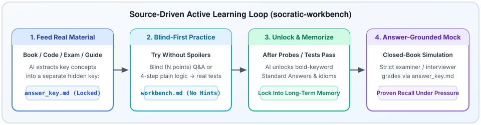

<div align="center">

# AI Study Workbench (`socratic-workbench`)

**Pasa cualquier libro, manual, repositorio de código o temario a la IA: extracción de respuestas estándar · cuaderno de práctica sin spoilers · desbloqueo para memorizar tras superar la prueba · simulación realista a libro cerrado.**

[English](./README.md) · [简体中文](./README.zh-CN.md) · [繁體中文](./README.zh-TW.md) · [日本語](./README.ja.md) · [한국어](./README.ko.md) · **Español**

[](LICENSE)
[](skills/socratic-workbench/SKILL.md)
[](#c%C3%B3mo-funciona-el-bucle-de-4-pasos)

</div>

---

## ¿Qué es esto y qué problema resuelve?

Cuando le pides a una IA que resuma un libro técnico o un fragmento de código, todo parece comprensible mientras lo lees, pero al cerrar la ventana lo olvidas por completo. **AI Study Workbench** (`socratic-workbench`) es una habilidad de código abierto que aplica el **Aprendizaje Activo Basado en Fuentes** (Source-Driven Active Learning):

- **Bloqueo Físico de Spoilers con Dos Archivos** (Dual-File Spoiler Lock): Tu cuaderno `workbench.md` no contiene respuestas; las soluciones estándar extraídas de tu material se guardan en el archivo separado `answer_key.md`.
- **Bucle a Ciegas Primero** (Blind-First Loop): Debes escribir tus ideas o los 4 pasos en lenguaje natural sin ver la solución. Si cometes un error o falta un punto, la IA te repregunta mediante contraejemplos concretos.
- **Simulación Basada en Respuestas Estándar** (Answer-Grounded Mock): Tras superar las preguntas y memorizar las respuestas desbloqueadas, la IA utiliza esa misma guía para actuar como un examinador o entrevistador exigente a libro cerrado.

**¡Muy fácil de usar! Sin comandos complicados.** Instala la habilidad y comparte directamente en el chat tu **capítulo de libro, notas en PDF, código, temario de examen o material de idiomas**.

---

## Cómo funciona (El bucle de 4 pasos)



1. **Entrega material real a la IA -> Extraer respuestas estándar** (`answer_key.md` aislado)  
   Al compartir tu documentación o código, la IA extrae en segundo plano los principios clave, las trampas intuitivas y las **respuestas estándar**, manteniéndolas fuera de tu vista en un archivo independiente.
2. **Práctica a ciegas en tu cuaderno** (`workbench.md`)  
   Genera un cuaderno adaptado a tu materia: cada pregunta muestra únicamente `(N puntos en total)` y un espacio en blanco. En programación, basta con redactar en lenguaje natural los 4 pasos: estado, paso principal, guardas de borde y retorno. La IA solo responde con los aciertos (`2 / 3 puntos`) y un caso de fallo para que descubras la solución tú mismo.
3. **Desbloqueo de respuestas para memorizar**  
   Solo después de resolver las preguntas de seguimiento o superar todas las pruebas unitarias, se desbloquean en el cuaderno las **respuestas estándar en negrita** (o modismos de código limpios) para fijarlas en la memoria.
4. **Simulación a libro cerrado** (Mock Simulation)  
   Di a tu tutor "inicia la simulación del paso 4". La IA adoptará el papel de entrevistador técnico, examinador oral o interlocutor real evaluándote estrictamente contra las respuestas del paso 1.

---

## Aplicable a cualquier materia

| Material que entregas a la IA | Formato de práctica y enfoque | Tras aprobar: "Memorización + Simulación" | Ejemplos |
|---|---|---|---|
| **Libros / Manuales / Humanidades** | Deducir mecanismos y refutar intuiciones con experimentos mentales | Memorizar tesis en negrita -> Simulación de debate y examen oral | [Cuaderno](examples/01-textbook-supply-demand/workbench.md) · [Soluciones](examples/01-textbook-supply-demand/answer_key.md) |
| **Repositorios / Diseño de Sistemas** | Sin recordar sintaxis: **4 pasos en lenguaje natural** -> Compilación 1:1 -> Tests | Aprender código idiomático -> Simulación de revisión de arquitectura | [Cuaderno](examples/02-coding-token-bucket/workbench.md) · [Tests](examples/02-coding-token-bucket/test_exercise.py) |
| **Certificaciones / Entrevistas** | Respuestas a ciegas por puntos + diagnóstico de incidentes | Tarjetas de memoria con palabras clave -> Simulación de entrevista bajo presión | [Cuaderno](examples/03-interview-mvcc/workbench.md) · [Soluciones](examples/03-interview-mvcc/answer_key.md) |
| **Idiomas / Negociación Laboral** | Responder ante situaciones reales antes de ver frases modelo | Memorizar expresiones pulidas -> Juego de rol conversacional de varios turnos | [Cuaderno](examples/04-language-workplace-pushback/workbench.md) · [Soluciones](examples/04-language-workplace-pushback/answer_key.md) |

---

## Instalación en 30 segundos

### Opción 1: Antigravity / Claude Code / Codex (`npx skills`)

```bash
# Instalar directamente desde GitHub:
npx skills add leileigwl/ai-study-workbench

# O instalar localmente desde una copia clonada:
npx skills add ./ai-study-workbench
```

También puedes copiar la carpeta directamente en tu directorio global de habilidades:

```bash
cp -r ai-study-workbench/skills/socratic-workbench ~/.agents/skills/
```

Habla con tu agente de forma natural:
> "Usa `socratic-workbench` con este material (libro/código/examen): extrae las respuestas estándar, crea un cuaderno a ciegas, ayúdame a memorizarlo y haz una simulación final."

### Opción 2: Cursor

Coloca [`adapters/cursor/socratic-workbench.mdc`](adapters/cursor/socratic-workbench.mdc) en `.cursor/rules/`.

### Opción 3: ChatGPT / Claude / Gemini en la Web (Sin instalación)

Copia y pega [`adapters/web-llm/system-prompt.en.md`](adapters/web-llm/system-prompt.en.md) (o la [versión en chino](adapters/web-llm/system-prompt.zh-CN.md)) al inicio de una conversación junto con tu texto.

---

## Preguntas Frecuentes (FAQ)

**1. ¿Las preguntas son inventadas o se basan en mi material?**  
Se basan al 100 % en el material que tú facilitas. El paso 1 extrae las respuestas directamente de tu documento o código, y las simulaciones posteriores utilizan esa misma pauta.

**2. ¿Funciona en modelos más pequeños o rápidos (como Flash) sin revelar respuestas?**  
Sí. Como las respuestas están físicamente separadas en `answer_key.md` y la habilidad cuenta con directivas estrictas de puntuación ([coach-behavior.md](skills/socratic-workbench/references/coach-behavior.md)), los modelos pequeños no filtran la solución antes de tiempo.

**3. ¿Licencia?**  
[Licencia MIT](LICENSE). Índice para motores de búsqueda de IA: [`llms.txt`](llms.txt).
