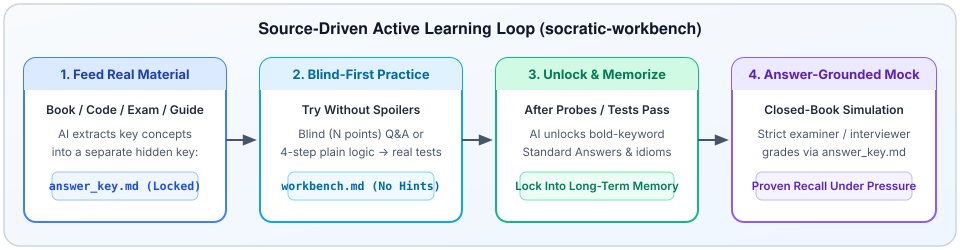

<div align="center">

# AI Study Workbench (`socratic-workbench`)

**教科書・専門書・コードベース・試験対策資料をAIに渡すだけ。模範解答を事前抽出・ネタバレなし練習帳でブラインド演習・合格後に解答解除して暗記・最後に模範解答をもとにクローズドブック模擬セッション。**

[English](./README.md) · [简体中文](./README.zh-CN.md) · [繁體中文](./README.zh-TW.md) · **日本語** · [한국어](./README.ko.md) · [Español](./README.es.md)

[](LICENSE)
[](skills/socratic-workbench/SKILL.md)
[](#4ステップの資料駆動ループ)

</div>

---

## これは何か？何を解決するのか？

普段、教科書や技術書、コードをAIに要約させると、読んでいるときは分かった気になりますが、画面を閉じると何も残りません。**AI Study Workbench**（`socratic-workbench`）は、**資料駆動型アクティブラーニング**（Source-Driven Active Learning）を実現するオープンソースのスキルです：

- **2ファイル物理ネタバレ分離**（Dual-File Spoiler Lock）：練習帳 `workbench.md` には答えを一切含めず、資料から抽出した模範解答は `answer_key.md` に隔離。
- **ブラインド先行ループ**（Blind-First Loop）：まず自分の言葉や4ステップの日本語ロジックで答えさせ、漏れや誤りは反例やテストケースで問い直します。
- **模範解答基準の模擬実践**（Answer-Grounded Mock）：練習後に解除された模範解答を暗記したら、AIがその模範解答を採点ルーブリックとして厳しい面接官・試験官になりきり、口頭試問やストレステストを実施します。

**使い方は簡単！コマンド引数は不要です。** スキルを導入後、チャットに **教科書の章、PDF/ノート、GitHubリポジトリ、試験要綱、語学教材** をそのまま投げかけるだけで学習が始まります。

---

## 4ステップの資料駆動ループ



1. **実資料をAIに渡す -> 模範解答ライブラリを抽出**（`answer_key.md` に隔離保存）  
   教科書・ドキュメント・コードを渡すと、AIが重要ポイント・直感の罠・**模範解答**（採点項目）を裏で抽出し、学習者には見えない独立ファイルに保存します。
2. **ネタバレなし練習帳でブラインド演習**（`workbench.md`）  
   分野に合わせた練習帳を生成：各設問は `(計 N 項目)` と空欄のみ。プログラミングなら「状態・主処理・境界条件・戻り値」の4ステップを書くだけ。AIは得点状況（例：`2 / 3 項目正解`）と失敗シナリオだけを返し、自力で穴を埋めさせます。
3. **合格後に模範解答を解除して暗記**  
   追問を自力でクリア、またはテストが全パスした後に初めて、太字キーワードでまとめた **暗記用模範解答** が練習帳に書き込まれます。
4. **模範解答をもとに脱稿模擬セッション**（Mock Simulation）  
   「第4ステップの模擬を開始して」と伝えるだけで、AIが先ほどの模範解答を採点カードとし、面接官や試験官として容赦ない反論や深掘り質問を行い、定着を完璧にします。

---

## あらゆる分野に対応（専門用語を自動調整）

| AIに渡す資料 | 演習形式とコーチング重点 | 合格後の「暗記解除 ＋ 模擬実践」 | サンプル（クリックで確認） |
|---|---|---|---|
| **教科書 / 専門書 / 人文書** | コアメカニズムの言語化・直感の誤りを思考実験で追及 | 精練された要点を暗記 -> 「口頭諮問・反論ディベート」模擬 | [ワークブック](examples/01-textbook-supply-demand/workbench.md) · [模範解答](examples/01-textbook-supply-demand/answer_key.md) |
| **コードベース / システム設計** | 文法不要：**自然言語4ステップ** -> 1:1翻訳 -> リアルテスト実行 | クリーンな熟語コード学習 -> 「高負荷・耐障害アーキテクチャレビュー」模擬 | [ワークブック](examples/02-coding-token-bucket/workbench.md) · [単体テスト](examples/02-coding-token-bucket/test_exercise.py) |
| **資格試験 / 技術面接ハンドブック** | 採点ポイント別ブラインド解答 + 障害解析シナリオ | 太字キーワードカード暗記 -> 「高圧面接官の連問模擬」 | [ワークブック](examples/03-interview-mvcc/workbench.md) · [模範解答](examples/03-interview-mvcc/answer_key.md) |
| **語学テキスト / ビジネス対話** | 模範文を見ずに現場のシチュエーションでまず発話 | 改善した自然表現を暗記 -> 「複数ターンの実戦会話ロールプレイ」 | [ワークブック](examples/04-language-workplace-pushback/workbench.md) · [模範解答](examples/04-language-workplace-pushback/answer_key.md) |

---

## 30秒クイックインストール

### 方法 1：Antigravity / Claude Code / Codex（`npx skills` 対応）

```bash
# GitHubから直接インストール：
npx skills add leileigwl/ai-study-workbench

# またはローカルクローン先からインストール：
npx skills add ./ai-study-workbench
```

グローバルスキルディレクトリに手動コピーも可能です：

```bash
cp -r ai-study-workbench/skills/socratic-workbench ~/.agents/skills/
```

チャットで資料を共有して伝えるだけ：
> 「`socratic-workbench` を使ってこの資料（教科書/コード/試験ガイド）を学習したいです。模範解答を抽出してネタバレなし練習帳を作成し、演習後に暗記させて模擬セッションを行ってください。」

### 方法 2：Cursor

[`adapters/cursor/socratic-workbench.mdc`](adapters/cursor/socratic-workbench.mdc) を `.cursor/rules/` に配置してください。

### 方法 3：ChatGPT / Claude / Gemini Webチャット（設定不要）

[`adapters/web-llm/system-prompt.en.md`](adapters/web-llm/system-prompt.en.md)（または [中国語版](adapters/web-llm/system-prompt.zh-CN.md)）をコピーしてチャットの冒頭に貼り付けるだけです。

---

## よくある質問

**1. 設問や模範解答はAIの創作ですか？それとも手持ちの資料に基づくものですか？**  
完全にあなたが渡した資料に基づきます。ステップ1で資料から直接要点と模範解答を抽出し、その後の採点・暗記・ステップ4の模擬セッションもすべてその解答を基準に行われます。

**2. 安価な小型モデル（Flashなど）でもネタバレせずに動作しますか？**  
模範解答が別ファイル `answer_key.md` に物理分離されており、[`coach-behavior.md`](skills/socratic-workbench/references/coach-behavior.md) による厳格なガードレールがあるため、小型モデルでも早期漏洩せず安定動作します。

**3. ライセンス？**  
[MIT License](LICENSE)。AI検索エンジン向けインデックス：[`llms.txt`](llms.txt)。
