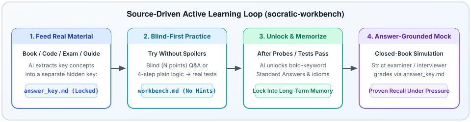

<div align="center">

# AI Study Workbench (`socratic-workbench`)

**교과서, 전문 서적, 코드베이스, 시험 대비 자료를 AI에 넣기만 하세요: 모범 답안 사전 추출 · 스포일러 방지 연습장 블라인드 학습 · 통과 후 정답 잠금 해제 암기 · 모범 답안 기반 모의 실전 시뮬레이션.**

[English](./README.md) · [简体中文](./README.zh-CN.md) · [繁體中文](./README.zh-TW.md) · [日本語](./README.ja.md) · **한국어** · [Español](./README.es.md)

[](LICENSE)
[](skills/socratic-workbench/SKILL.md)
[](#4단계-자료-기반-루프)

</div>

---

## 이것은 무엇이며, 무엇을 해결하는가?

평소 교과서나 기술 서적, 코드를 AI에 요약시키면 읽을 때는 다 아는 것 같지만 창을 닫으면 머리에 남지 않습니다. **AI Study Workbench** (`socratic-workbench`)는 **자료 기반 능동 학습** (Source-Driven Active Learning)을 구현하는 오픈소스 스킬입니다:

- **2개 파일 물리적 스포일러 분리** (Dual-File Spoiler Lock): 연습장 `workbench.md` 에는 정답을 전혀 넣지 않으며, 자료에서 추출한 모범 답안은 `answer_key.md` 에 안전하게 격리합니다.
- **블라인드 우선 루프** (Blind-First Loop): 정답을 먼저 보지 않고 본인의 키워드나 4단계 자연어 로직으로 먼저 작성하게 하며, 누락된 부분은 반례나 실패 시나리오로 되물어 직접 깨닫게 합니다.
- **모범 답안 기반 모의 실전** (Answer-Grounded Mock): 연습을 통과하고 해제된 모범 답안을 암기한 뒤, AI가 그 답안을 루브릭으로 삼아 엄격한 면접관이나 시험관이 되어 클로즈드북 실전 압박 질문을 진행합니다.

**사용법은 아주 간단합니다! 복잡한 CLI 명령어가 필요 없습니다.** 스킬을 설치한 후 대화창에 **교과서 챕터, PDF/필기, 깃허브 코드, 시험 가이드, 어학 교재** 를 그냥 붙여넣고 자연스럽게 대화하세요.

---

## 4단계 자료 기반 루프



1. **실제 자료 제공 -> 모범 답안 라이브러리 추출** (`answer_key.md` 격리 저장)  
   교재나 문서를 제공하면, AI가 핵심 메커니즘, 흔한 오개념 함정, **모범 답안** 을 추출하여 학습자에게 보이지 않는 독립 파일에 저장합니다.
2. **스포일러 없는 연습장에서 블라인드 학습** (`workbench.md`)  
   분야에 맞춤화된 연습장을 생성합니다: 각 문항은 `(총 N개 포인트)` 와 빈칸만 제공됩니다. 코딩의 경우 "상태, 메인 단계, 예외 방어, 반환값" 4단계만 자연어로 작성하면 됩니다. AI는 정답 여부(예: `2 / 3개 적중`)와 구체적인 실패 시나리오만 제시하여 스스로 채우게 합니다.
3. **통과 후 모범 답안 잠금 해제 및 암기**  
   스스로 힌트를 통과하거나 단위 테스트를 모두 통과한 뒤에만 볼드체 키워드로 요약된 **암기용 모범 답안** 이 연습장에 채워집니다.
4. **모범 답안을 기준으로 한 모의 실전** (Mock Simulation)  
   "4단계 모의 실전 시작해 줘"라고 말하면, AI가 1단계에서 추출했던 답안을 유일한 채점 기준으로 삼아 날카로운 질문을 던지는 면접관/시험관으로 변신합니다.

---

## 모든 분야에 적용 가능 (맞춤형 용어 자동 전환)

| AI에 넣을 자료 | 연습 방식 및 코칭 중점 | 합격 후 "암기 해제 + 모의 실전" | 샘플 (클릭하여 확인) |
|---|---|---|---|
| **교과서 / 전공서 / 인문서** | 핵심 메커니즘 도출, 사고 실험으로 직관의 오류 반박 | 정제된 핵심 논점 암기 -> 구술시험 및 반론 토론 모의 실전 | [워크북](examples/01-textbook-supply-demand/workbench.md) · [모범답안](examples/01-textbook-supply-demand/answer_key.md) |
| **코드베이스 / 시스템 아키텍처** | 문법 고민 없이: **자연어 4단계 작성** -> 1:1 코드 변환 -> 실제 테스트 | 간결한 모범 코드 학습 -> 대규모 동시성/장애 아키텍처 리뷰 모의 | [워크북](examples/02-coding-token-bucket/workbench.md) · [단위테스트](examples/02-coding-token-bucket/test_exercise.py) |
| **자격시험 / 면접 핸드북** | 채점 포인트별 블라인드 답변 + 장애 진단 시나리오 | 볼드체 키워드 카드 암기 -> 압박 면접 연쇄 질문 모의 실전 | [워크북](examples/03-interview-mvcc/workbench.md) · [모범답안](examples/03-interview-mvcc/answer_key.md) |
| **어학 교재 / 비즈니스 회화** | 모범 답안을 보지 않고 실전 상황에서 먼저 발화 | 다듬어진 원어민 표현 암기 -> 다중 턴 실전 회화 롤플레잉 | [워크북](examples/04-language-workplace-pushback/workbench.md) · [모범답안](examples/04-language-workplace-pushback/answer_key.md) |

---

## 30초 빠른 시작

### 방법 1: Antigravity / Claude Code / Codex (`npx skills` 지원)

```bash
# 깃허브에서 직접 설치:
npx skills add leileigwl/ai-study-workbench

# 또는 로컬 클론 경로에서 설치:
npx skills add ./ai-study-workbench
```

전역 스킬 디렉토리에 수동 복사도 가능합니다:

```bash
cp -r ai-study-workbench/skills/socratic-workbench ~/.agents/skills/
```

대화창에서 자료를 공유하고 말하세요:
> "`socratic-workbench` 스킬로 이 교재(교과서/코드/시험요강)를 학습할래. 모범 답안을 추출하고 스포일러 없는 연습장을 만들어 줘. 연습 끝나면 답안 암기시키고 모의 실전까지 진행해 줘."

### 방법 2: Cursor

[`adapters/cursor/socratic-workbench.mdc`](adapters/cursor/socratic-workbench.mdc) 를 `.cursor/rules/` 에 추가하세요.

### 방법 3: ChatGPT / Claude / Gemini 웹 대화 (설치 불필요)

[`adapters/web-llm/system-prompt.en.md`](adapters/web-llm/system-prompt.en.md) 프롬프트를 복사하여 새 대화 첫 메시지에 붙여넣기만 하면 됩니다.

---

## 자주 묻는 질문 (FAQ)

**1. 문제는 AI가 지어내는 건가요, 아니면 내 교재를 기반으로 하나요?**  
100% 여러분이 제공한 자료를 기반으로 합니다. 1단계에서 교재나 코드에서 직접 모범 답안을 추출하며, 이후 채점과 4단계 모의시험도 해당 내용을 기준으로 진행됩니다.

**2. Flash 등 가벼운 모델에서도 스포일러 없이 잘 작동하나요?**  
모범 답안이 물리적으로 분리되어 있고 [`coach-behavior.md`](skills/socratic-workbench/references/coach-behavior.md) 가드레일이 적용되어 가벼운 모델에서도 답을 미리 누출하지 않습니다.

**3. 라이선스?**  
[MIT License](LICENSE). AI 검색엔진 색인: [`llms.txt`](llms.txt).
