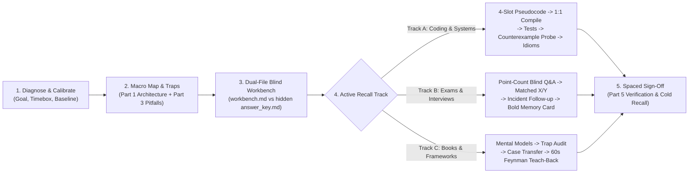

<div align="center">

# AI Study Workbench (`socratic-workbench`)

**Stop letting AI spoil your learning. Turn any coding agent or LLM into a strict, spoiler-free Socratic coach across Coding, Interviews, and Books.**

[English](README.md) | [简体中文](README.zh-CN.md) | [Methodology](docs/METHODOLOGY.md) | [llms.txt](llms.txt)

[](LICENSE)
[](skills/socratic-workbench/SKILL.md)
[](docs/METHODOLOGY.md)
[](llms.txt)

</div>

---

## What Is AI Study Workbench?

> **Canonical Definition**: **AI Study Workbench (`socratic-workbench`)** is an open-source, cross-agent **Skill specification, Cursor rule, and Web-LLM methodology** built on a **"1+3" multi-domain architecture**. Instead of letting AI dump complete answers or silently fix broken logic, it enforces **dual-file spoiler separation** (`workbench.md` vs. `answer_key.md`), **scenario-based gap probing**, and **1:1 literal 4-slot native-language pseudocode compilation** verified by deterministic tests—making active recall work reliably across coding, system design interviews, exams, and non-fiction books, even on lightweight/Flash-tier models.

---

## Why Conventional AI Learning Fails (Comparison Matrix)

Most people think they are learning fast with AI—until an interview or production outage proves they only rented fluency.

| Dimension | Passive AI Chat ("Explain / Solve This") | Traditional Flashcards (Anki / Q&A Docs) | **AI Study Workbench (`socratic-workbench`)** |
|---|---|---|---|
| **Premature Spoilers** | High — AI reveals complete answers & code immediately | Medium — answers live in the same deck/file | **Zero** — strict separation between `workbench.md` & `answer_key.md` |
| **Coding & Syntax Bottleneck** | Either copy-paste with zero retention, or fight boilerplate syntax slowly | Poor fit for stateful algorithms & concurrency | **4-Slot Pseudocode Compiler** — you own logic invariants; AI compiles syntax 1:1 literally |
| **Edge-Case Ownership** | AI quietly patches bounds you forgot to specify | Static text cannot run against your logic | **No Silent Fixes** — failing unit tests expose missing rules via raw counterexamples |
| **Missed Conceptual Points** | AI spoils everything you forgot in bullet points | Pass/fail self-grading without deeper testing | **Scenario Probing** — AI scores `Matched: X / Y` and invents failure incidents for gaps |
| **Lightweight / Flash Model Stability** | Easily drifts into flattery or full-answer shortcuts | N/A | **4-Gate Guardrail Protocol** keeps even small/Flash models strict |
| **Domain Breadth** | Ad-hoc | Mostly factual recall | **"1+3" Tracks**: Coding & Systems, Exams & Interviews, Books & Mental Models |

---

## How the "1 + 3" Architecture Works



### The Four Core Iron Laws

1. **Dual-File Anti-Spoiler Separation**: Questions in `workbench.md` show **only** `(N core points)` and empty draft slots (`> My Draft:`). Rubrics, scoring keywords, and follow-up scenarios live strictly inside `answer_key.md`.
2. **Literal 1:1 Pseudocode Compilation**: For coding drills, write **4 plain-language slots** (*1. State & Containers / 2. Core Step / 3. Boundary Guards / 4. Return Contract*). The AI compiles your words verbatim—never silently adding unmentioned guards—and lets real tests (`pytest` / `unittest`) break blind spots.
3. **Counterexamples Over Hints**: On failure or missed points, the AI outputs exact scores (`Matched: 2 / 4`, `Passed: 4 / 6`), quotes a concrete failing input or incident scenario, and asks *you* to patch the rule. Zero flattery.
4. **Post-Pass Idiom Anatomy**: Only *after* tests pass 100% does the AI reveal 1–2 concise engineering idioms from clean reference code, transferring architectural taste without tedious syntax memorization.

---

## Three Neutral, Ready-to-Inspect Examples

Every track ships with a complete, self-contained example inside [`examples/`](examples):

| Track | Domain Focus | Showcase Unit | Key Artifact |
|---|---|---|---|
| **Track A (`coding`)** | Code, Algorithms & Systems | **Token Bucket Rate Limiter** | [`workbench.md`](examples/track-a-coding-token-bucket/workbench.md) · [`test_exercise.py`](examples/track-a-coding-token-bucket/test_exercise.py) · [`solution.py`](examples/track-a-coding-token-bucket/solution.py) |
| **Track B (`interview`)** | Technical Interviews & Exams | **Database MVCC & Write Skew** | [`workbench.md`](examples/track-b-interview-mvcc/workbench.md) · [`answer_key.md`](examples/track-b-interview-mvcc/answer_key.md) |
| **Track C (`book`)** | Books, Business & Humanities | **Thinking in Systems (Meadows)** | [`workbench.md`](examples/track-c-book-systems-thinking/workbench.md) · [`answer_key.md`](examples/track-c-book-systems-thinking/answer_key.md) |

---

## Quickstart: Use With Your Favorite AI Tool

### 1. Antigravity / Claude Code / OpenAI Codex (`SKILL.md`)

Install via [`npx skills`](https://skills.sh/) (after publishing) or copy [`skills/socratic-workbench/`](skills/socratic-workbench) into your project or global skills directory:

```bash
# Project-local installation (Antigravity / universal .agents convention)
mkdir -p .agents/skills
cp -r path/to/ai-study-workbench/skills/socratic-workbench .agents/skills/

# Or Claude Code project skills
mkdir -p .claude/skills
cp -r path/to/ai-study-workbench/skills/socratic-workbench .claude/skills/

# Or via npx skills once hosted on GitHub:
npx skills add <your-handle>/ai-study-workbench
```

Then ask your agent:
> *"Use `socratic-workbench` to turn this chapter/repo/exam syllabus into a Track A/B/C study workbench without spoilers."*

### 2. Cursor (`.mdc` Rule)

Copy [`adapters/cursor/socratic-workbench.mdc`](adapters/cursor/socratic-workbench.mdc) into your repository's `.cursor/rules/` folder. It activates automatically whenever `workbench.md` or `exercise.*` files are open.

### 3. Web LLMs (ChatGPT / Claude / Gemini / DeepSeek — Zero Setup)

Copy and paste the ready-made System Prompt into Custom Instructions, a Project, or a Gem:
- English: [`adapters/web-llm/system-prompt.en.md`](adapters/web-llm/system-prompt.en.md)
- 简体中文: [`adapters/web-llm/system-prompt.zh-CN.md`](adapters/web-llm/system-prompt.zh-CN.md)

### 4. Scaffold & Validate Any Study Unit via CLI (Zero Dependencies)

```bash
# Create a new blind workbench + separated answer key
python3 skills/socratic-workbench/scripts/init_workbench.py \
  --dir ./study-notes/unit-01 \
  --title "Consistent Hashing" \
  --track coding

# Verify 5-part structure, zero spoiler leaks, and 1:1 Q-ID parity
python3 skills/socratic-workbench/scripts/init_workbench.py \
  --dir ./study-notes/unit-01 \
  --check
```

---

## Repository Layout

```text
ai-study-workbench/
├── skills/socratic-workbench/
│   ├── SKILL.md                             # Core cross-agent skill state machine
│   ├── references/
│   │   ├── weak-model-guardrails.md         # Flash/small-model anti-shortcut contract
│   │   ├── workbench-template.md            # Dual-file 5-part schema
│   │   ├── track-coding-architecture.md     # Track A: 4-slot pseudocode -> literal compile
│   │   ├── track-exams-interviews.md        # Track B: Point-counted recall & incident probing
│   │   └── track-books-frameworks.md        # Track C: Mental models & Feynman transfer
│   └── scripts/
│       └── init_workbench.py                # Scaffolder & anti-spoiler linter (--check)
├── adapters/
│   ├── cursor/socratic-workbench.mdc        # Cursor IDE rule
│   └── web-llm/                             # Copy-paste System Prompts (EN / ZH-CN)
├── examples/                                # 3 complete neutral showcase units
├── docs/                                    # Cognitive methodology, GEO/SEO playbook & roadmap
├── llms.txt & llms-full.txt                 # Machine-readable specs for AI search engines
└── CITATION.cff                             # Standard scholarly & tool citation metadata
```

---

## Frequently Asked Questions (FAQ)

**How do you stop AI from spoiling answers while studying?**  
Prompting alone fails because LLMs default to helpfulness, especially in long chats or on smaller models. Separating `workbench.md` (questions + empty draft slots only) from `answer_key.md` (rubric + probing triggers), paired with a 4-check self-gate before every reply, enforces structural spoiler isolation.

**Can I learn programming concepts and system design with AI if I forgot syntax?**  
Yes—that is what **Track A (`coding`)** was engineered for. You write logic in **4 plain-language slots** (Containers, Core Step, Boundary Guards, Return Contract) in English or Chinese. The AI compiles syntax literally into `exercise.*`, runs unit tests, and challenges you only when a concrete test input fails. Once green, you inspect 1–2 high-value idioms in `solution.*`.

**How is this useful outside programming (books, exams, management)?**  
Track B (`interview`) stress-tests conceptual recall using point counts and real-world edge-case incidents. Track C (`book`) forces you to extract causal mental models, list intuition traps, transfer the author's framework to an unfamiliar scenario, and pass a 60-second jargon-free Feynman teach-back.

**Does it work on cheaper / lightweight Flash models without prompt drift?**  
Yes. See [`references/weak-model-guardrails.md`](skills/socratic-workbench/references/weak-model-guardrails.md): banned filler praise, deterministic scoring headers (`Matched: X / Y`, `Passed: A / B`), and externalized rubrics keep small models tightly bounded.

---

## License & Citation

Released under the [MIT License](LICENSE). Academic or tooling citations are supported via [`CITATION.cff`](CITATION.cff). See [`docs/GEO_SEO_GUIDE.md`](docs/GEO_SEO_GUIDE.md) and [`docs/ROADMAP_CHECKPOINT.md`](docs/ROADMAP_CHECKPOINT.md) before tagging `v1.0.0`.
