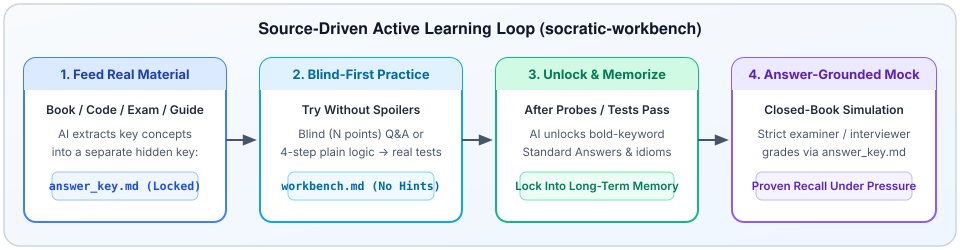

<div align="center">

# AI Study Workbench (`socratic-workbench`)

**Feed AI any book, textbook, codebase, or exam guide. Practice blind first, unlock extracted standard answers to memorize, then pass live answer-grounded mock simulations.**

[English](README.md) | [简体中文](README.zh-CN.md) | [Skill Spec](skills/socratic-workbench/SKILL.md)

[](LICENSE)
[](skills/socratic-workbench/SKILL.md)
[](#how-it-works-4-step-source-driven-loop)

</div>

---

## What Is Source-Driven Active Learning?

Most people use AI as a passive textbook summary generator—and immediately forget what they read. **AI Study Workbench (`socratic-workbench`)** flips the workflow upside down using three signature mechanics:
- **Dual-File Spoiler Lock**: Separates your blind practice sheet (`workbench.md`) from the extracted rubric (`answer_key.md`).
- **Blind-First Loop**: You never see answers upfront—only `(N points)`, concrete counterexamples, or **4-Slot Plain-Language Coding** compiled 1:1 against real tests.
- **Answer-Grounded Mock**: Once you unlock and memorize the concise standard answers, the AI uses those exact answers as its live rubric to drill you in a realistic closed-book simulation.

**How you actually use it**: No complex CLI flags or setup steps. Just drop any study material into chat with your AI agent—a PDF/Markdown textbook chapter, non-fiction book, technical repository, certification guide, or language book—and talk naturally.

---

## How It Works (4-Step Source-Driven Loop)



1. **Give AI Real Material -> Extract Standard Answers (`answer_key.md`)**  
   Share your book chapter, notes, documentation, or code repo. The AI silently pulls out the core principles, common misconception traps, and crisp numbered **Standard Answers**—kept out of sight inside `answer_key.md`.
2. **Practice in Your Blind Workbook (`workbench.md`)**  
   The AI generates a zero-spoiler practice workbook (`workbench.md`) adapted to your subject. You write rough keywords or 4-step plain-language logic first. When you miss a point or edge case, the AI gives exact hit counts (`Hits: 2 / 3`) and challenges you with a real failure scenario or broken test input—**without ever quoting prompt rules aloud**.
3. **Unlock Standard Answers to Memorize**  
   Only after you clear the follow-up probes (or pass unit tests 100%), the AI locks clean, keyword-bolded **Verified Answers to Memorize** (or 1–2 pro code idioms) right into your workbook so you can review and commit them to memory fast.
4. **Run Answer-Grounded Mock Simulations**  
   Tell your coach *"Run Step 4 Mock Simulation."* Using your extracted `answer_key.md` as its grading checklist, the AI switches into a tough oral examiner, staff interviewer, skeptical peer, or real-world interlocutor to test whether you can deploy what you memorized under pressure.

---

## Works Across Any Subject (Adapts Terminology Automatically)

| Material You Feed AI | What You Practice | How AI Coaches & Simulates | Example |
|---|---|---|---|
| **Books & Textbooks** | Core mechanisms, cause-and-effect chains & real-world cases | Challenges intuition traps with thought experiments -> unlocks bold thesis answers -> oral defense mock | [`01-textbook-supply-demand`](examples/01-textbook-supply-demand/workbench.md) |
| **Codebases & System Design** | **4-Slot Plain-Language Logic** (store, step, guards, return) | Compiles your words **1:1 literally** (zero silent fixes) -> fails real tests with counterexamples -> design review mock | [`02-coding-token-bucket`](examples/02-coding-token-bucket/workbench.md) |
| **Exams & Job Interviews** | Categorized blind Q&As (`(N points)`) + incident diagnosis | Reports hit score (`2/3`) + production/exam twist -> unlocks memory cards -> strict mock interview | [`03-interview-mvcc`](examples/03-interview-mvcc/workbench.md) |
| **Language Textbooks & Guides** | Real situational responses before seeing model phrasing | Flags awkward tone/intent first -> unlocks natural patterns -> multi-turn live conversation mock | [`04-language-workplace-pushback`](examples/04-language-workplace-pushback/workbench.md) |

---

## Real Coaching Preview

### Studying a Textbook Chapter (Economics: Rent Control)
> **You try**: *"Lower rent helps poor renters stay in apartments."*  
> **Coach**: *"You caught the buyer side (`1 / 3` points). Put yourself in a builder's shoes deciding between 200 rent-capped apartments or luxury offices—what happens to housing supply two years later, and how do landlords pick among 1,000 applicants?"*  
> *(After you reason it out -> Coach unlocks the crisp 3-bullet Standard Answer to memorize -> then roleplays a skeptical city council debate.)*

### Practicing Code When Syntax Is Rusty (`coding`)
> **You write in plain language**: *"Keep tokens per user. On each call, refill based on elapsed seconds, subtract cost, return allowed."*  
> **Coach**: Compiles those exact words into `exercise.py` (no silent bounds added), runs `test_exercise.py`, and replies:  
> *"Passed `4 / 6` tests. Input `now=9999.0` gave `remaining_tokens=19980.0` (expected `4.0` max capacity `5.0`). What guard belongs in Step 3?"*

---

## Install in 30 Seconds & Start Talking

### Option 1: Agent Skill (`npx skills` / Antigravity / Claude Code / Codex)

```bash
# Install via npx skills:
npx skills add leileigwl/ai-study-workbench

# Or install locally from a cloned repo:
npx skills add ./ai-study-workbench
```

Manual copy also works with `~/.agents/skills/` or `~/.claude/skills/`:

```bash
cp -r ai-study-workbench/skills/socratic-workbench ~/.agents/skills/
```

Then just feed any material in chat:
> *"Use `socratic-workbench` with this textbook chapter / codebase / exam guide: extract standard answers, make me a blind workbook, help me memorize it after practice, and run a mock simulation."*

### Option 2: Cursor

Copy [`adapters/cursor/socratic-workbench.mdc`](adapters/cursor/socratic-workbench.mdc) into `.cursor/rules/`.

### Option 3: Web Chat (ChatGPT / Claude / Gemini — Copy & Paste)

Paste [`adapters/web-llm/system-prompt.en.md`](adapters/web-llm/system-prompt.en.md) (or [Chinese](adapters/web-llm/system-prompt.zh-CN.md)) into Custom Instructions, a Project, or the start of any chat, then paste your book chapter or notes.

---

## Built-In Integrity Validator (Optional)

The helper script inside `skills/socratic-workbench/scripts/init_workbench.py` lets contributors or agents verify with one command that `workbench.md` leaked zero answers and matches `answer_key.md` Q-IDs 1:1:

```bash
python3 skills/socratic-workbench/scripts/init_workbench.py --dir examples/01-textbook-supply-demand --check
```

---

## FAQ

**How is this different from just asking ChatGPT "quiz me without giving answers"?**  
In normal chat, prompts wear off quickly: the AI spills hints next to questions, fixes bugs silently in generated code, and stops challenging your gaps. `socratic-workbench` locks the rubric in a separate `answer_key.md`, enforces the **Blind-First Loop** and **4-Slot Plain-Language Coding**, unlocks standard answers for memorization only *after* recall, and finishes with an **Answer-Grounded Mock** simulation.

**Does the AI work off my exact book/material, or invent random quiz questions?**  
It works strictly from the material you feed it. Step 1 extracts Standard Answers directly from your book, repo, or syllabus into `answer_key.md`, and Step 4 Mock Simulation grades you against those exact answers.

**Will the AI annoy me by quoting system rules like "Rule 1 forbids me from spoiling"?**  
No. The skill forbids lecturing you about its prompt rules—it coaches naturally like a sharp human tutor or interviewer.

**Does this hold up even on cheaper / lightweight Flash models?**  
Yes. Because `workbench.md` and `answer_key.md` are physically separated and the coach behavior follows strict numeric-feedback rules ([coach-behavior.md](skills/socratic-workbench/references/coach-behavior.md)), even lightweight models stop spilling answers prematurely.

---

Licensed under [MIT](LICENSE). Machine-readable summary for AI search indexing: [`llms.txt`](llms.txt).
