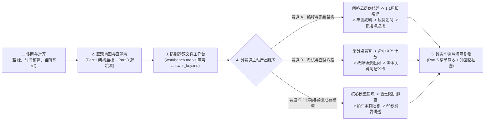

<div align="center">

# AI Study Workbench (`socratic-workbench`)

**别再让 AI 替你“剧透答案”造成虚假熟练感。用「防剧透盲答工作台 + 四格伪代码编译器」，把任意 Agent 或大模型变成涵盖编程、面试与读书的硬核陪练教练。**

[English](README.md) | [简体中文](README.zh-CN.md) | [方法论深读](docs/METHODOLOGY.md) | [llms.txt](llms.txt)

[](LICENSE)
[](skills/socratic-workbench/SKILL.md)
[](docs/METHODOLOGY.md)

</div>

---

## 这是什么？

> **核心定义**：**AI Study Workbench（`socratic-workbench`）** 是一套基于 **「1+3」多学科架构** 的开源跨平台 **Agent Skill 规范、Cursor 规则与网页端 System Prompt 方法论**。它通过 **双文件物理防剧透隔离**（`workbench.md` 与 `answer_key.md` 分离）、**故障场景追问补漏**、以及 **四格母语伪代码 1:1 死板编译+单测裁判机制**，把 AI 从“直接吐答案的作弊器”改造成“哪怕切换至 Flash 等轻量模型也绝不跑偏的苏格拉底陪练”。

---

## 为什么传统用 AI 学习容易“一看就会、一考就废”？

| 对比维度 | 普通 AI 对话（直接问“怎么写/讲讲”） | 传统闪卡 / 笔记文档 | **AI Study Workbench (`socratic-workbench`)** |
|---|---|---|---|
| **答案剧透风险** | 极高——AI 顺嘴就把完整答案和代码全吐出来了 | 中等——答案往往就在同一份文件里，极易偷看 | **物理隔离**：`workbench.md` 仅展示题干与 `(共 N 个采分点)`，答案独立锁在 `answer_key.md` |
| **编程忘语法 vs 假会** | 要么从头手搓语法耗时，要么复制 50 行 AI 代码却不懂边界 | 不适合状态机、并发与复杂边界推演 | **四格中文伪代码编译**：人类 100% 掌控容器、步骤、边界、返回逻辑；AI 1:1 死板编译 syntax |
| **AI 自动偷改 Bug** | 人类漏了边界判断，AI 写代码时偷偷顺手补齐了 | 无法运行验证 | **严禁脑补**：漏写的边界直接让单元测试挂掉，用真实失败输入反问你 |
| **概念题漏点补救** | 直接把你没想到的点列出来告诉你（虚假掌握） | 仅靠自己勾选“记住/忘了”，缺乏深层追问 | **场景故障追问**：只报 `已命中 X / Y`，用线上故障或极端用例逼你自己推导出漏掉的采分点 |
| **轻量/Flash 模型稳定性** | 长对话极易飘走、夸赞、提前泄题 | 无 | **四步状态机防偷懒铁律**，小模型也能稳定执行 |
| **适用领域** | 零散问答 | 偏死记硬背 | **「1+3」三赛道全覆盖**：编程与系统架构 / 考证与八股面试 / 商业与人文读书笔记 |

---

## 「1 + 3」多学科核心工作流



### 四条不可违背的铁律

1. **物理级防剧透隔离**：`workbench.md` 中每道题只放 `题目 + (共 N 个核心采分点)` 与空白作答槽，评分要点与追问触发器全部隔离在 `answer_key.md`。
2. **四格母语伪代码 1:1 死板编译**：做技术/算法题不用死磕生疏的语法细节，只需用中文或英文写清四格：**【1. 存什么容器 / 2. 循环或计算怎么走 / 3. 边界怎么防 / 4. 最后怎么交】**。AI 必须 1:1 忠实翻译——你没写的边界绝不替你脑补，直接跑单测暴露反例。
3. **只报命中数 + 反例追问，严禁客套吹捧**：禁止“思路太棒了”这类废话，直接输出 `已命中：2 / 4 个采分点` 或 `当前通过：4 / 6 个测试`，随后贴出具体故障场景或失败输入 JSON 进行追问。
4. **全绿后再点拨 1~2 个工程好写法**：只有在测试 100% 通过后，才对照参考解法提炼最简单、最省事的 1~2 个惯用法，让你只吸收设计品味而不必背诵死语法。

---

## 三赛道全新中性示例（开箱可看、可跑）

仓库内置三个完全独立、不绑定特定框架的实战样板（位于 [`examples/`](examples)）：

| 赛道 | 适用人群与场景 | 内置样板案例 | 核心文件 |
|---|---|---|---|
| **赛道 A (`coding`)** | 语法忘光、平时靠 AI 写代码，但必须吃透设计边界与并发原理 | **令牌桶限流器（Token Bucket）** | [`workbench.md`](examples/track-a-coding-token-bucket/workbench.md) · [`test_exercise.py`](examples/track-a-coding-token-bucket/test_exercise.py) · [`solution.py`](examples/track-a-coding-token-bucket/solution.py) |
| **赛道 B (`interview`)** | 技术面试系统设计、八股文精背、云厂商/司法/金融考证 | **数据库 MVCC 与 Write Skew 写偏斜** | [`workbench.md`](examples/track-b-interview-mvcc/workbench.md) · [`answer_key.md`](examples/track-b-interview-mvcc/answer_key.md) |
| **赛道 C (`book`)** | 读厚书易忘、划线无用，需要转化为真实决策能力的非虚构/商业书 | **《系统之美》（Thinking in Systems）** | [`workbench.md`](examples/track-c-book-systems-thinking/workbench.md) · [`answer_key.md`](examples/track-c-book-systems-thinking/answer_key.md) |

---

## 快速上手（全平台零门槛适配）

### 方式 1：Antigravity / Claude Code / Codex（标准 Skill）

将 [`skills/socratic-workbench/`](skills/socratic-workbench) 复制到项目的 `.agents/skills/` 或 `.claude/skills/` 目录（发布至 GitHub 后也可直接用 `npx skills add <your-handle>/ai-study-workbench` 安装）：

```bash
mkdir -p .agents/skills
cp -r path/to/ai-study-workbench/skills/socratic-workbench .agents/skills/
```

随后只需对你的 Agent 说：
> *“使用 `socratic-workbench` 技能，针对这份技术文档/考纲/书目，按赛道 A/B/C 给我生成防剧透学习工作台，并开始陪练。”*

### 方式 2：Cursor（`.mdc` 规则）

把 [`adapters/cursor/socratic-workbench.mdc`](adapters/cursor/socratic-workbench.mdc) 放进项目的 `.cursor/rules/` 目录，只要你打开任意 `workbench.md` 或 `exercise.*` 文件，规则自动生效。

### 方式 3：网页端大模型直接用（ChatGPT / Claude / Gemini / DeepSeek / Kimi）

无需任何本地环境！直接复制 [`adapters/web-llm/system-prompt.zh-CN.md`](adapters/web-llm/system-prompt.zh-CN.md) 里的整段提示词，粘贴到网页端 AI 的 **自定义指令（Custom Instructions） / Project / Gem**，或新对话第一条消息即可。

### 方式 4：自带脚手架与防剧透校验 CLI（零第三方依赖）

```bash
# 1. 一键生成任意赛道的双文件工作台模板
python3 skills/socratic-workbench/scripts/init_workbench.py \
  --dir ./study-notes/unit-01 \
  --title "一致性哈希 (Consistent Hashing)" \
  --track coding

# 2. 自动校验五模块完整性、零剧透泄漏以及 Q-ID 一一对应
python3 skills/socratic-workbench/scripts/init_workbench.py \
  --dir ./study-notes/unit-01 \
  --check
```

---

## 进阶阅读与开源发布路线

- [方法论认知科学原理 (`docs/METHODOLOGY.md`)](docs/METHODOLOGY.md)
- [GitHub SEO 与大模型引用 GEO 实操清单 (`docs/GEO_SEO_GUIDE.md`)](docs/GEO_SEO_GUIDE.md)
- [后续演进与回访提醒备忘 (`docs/ROADMAP_CHECKPOINT.md`)](docs/ROADMAP_CHECKPOINT.md)

基于 [MIT License](LICENSE) 开源，支持通过 [`CITATION.cff`](CITATION.cff) 进行引用。
