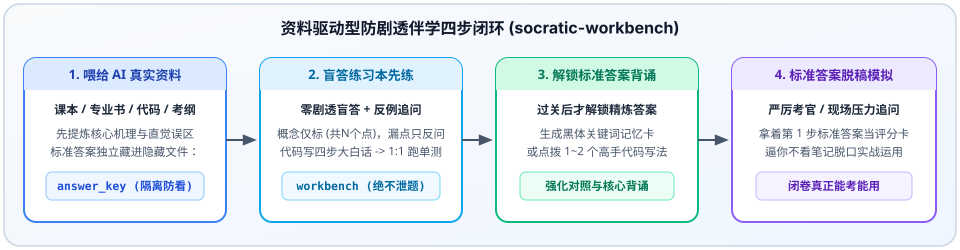

<div align="center">

# AI Study Workbench (`socratic-workbench`)

**把任何書本、課本、程式碼庫或備考資料餵給 AI：先提煉標準答案、生成無爆雷練習本帶你盲練；練完解鎖精煉答案去背誦；最後用這套標準答案直接做脫稿模擬實戰。**

[English](./README.md) · [简体中文](./README.zh-CN.md) · **繁體中文** · [日本語](./README.ja.md) · [한국어](./README.ko.md) · [Español](./README.es.md)

[](LICENSE)
[](skills/socratic-workbench/SKILL.md)
[](#怎麼用四步資料驅動閉環)

</div>

---

## 這是什麼？解決什麼痛點？

平時直接把課本、專業書或程式碼丟給 AI 總結，看著順暢無比，結果一關掉文件全忘光。**AI Study Workbench**（`socratic-workbench`）是一套 **資料驅動型防爆雷伴學**（Source-Driven Active Learning）技能：
- **雙文件防爆雷鎖**（Dual-File Spoiler Lock）：練習本 `workbench.md` 絕對不放答案；從你資料裡抽出來的標準答案單獨存進 `answer_key.md`。
- **盲練先導閉環**（Blind-First Loop）：先讓你想出關鍵詞或四格白話邏輯再批改，不提前爆雷，漏點只用反例/故障追問。
- **標準答案脫稿模擬**（Answer-Grounded Mock）：練完解鎖精煉標準答案讓你背完後，AI 直接拿著這批標準答案當「評分卡」，變身嚴格考官/面試官/現實對手做脫稿模擬。

**平時怎麼上手？不用記命令列參數！** 裝好 Skill 後，直接把你想學的 **書本章節、PDF/筆記、程式碼儲存庫、考綱或外語教材** 發進對話裡，跟 AI 正常聊天就行。

---

## 怎麼用？（四步資料驅動閉環）



1. **第一步：把真實資料餵給 AI，先抽出標準答案**（存進 `answer_key.md`）  
   你發來一章專業課本、一本商業好書、一段工程程式碼或考試大綱。AI 先吃透資料，把核心考點、常見直覺誤區和精煉的 **標準答案** 抽出來存進獨立文件（先不給你看）。
2. **第二步：在零爆雷練習本裡先盲練，漏點只反問**（`workbench.md`）  
   AI 按你的學科自動切換措辭生成 `workbench.md`：每道題只留 `(共 N 個要點)` 和空白作答區；程式設計題只需你填「存什麼、主步驟、邊界怎麼防、返回什麼」四句白話。你答完後，AI 只報命中數（比如 `命中 2 / 3`），針對漏掉的點甩一個現實反例或失敗測試輸入逼你自己補齊，全程絕不把內部規則念出來破壞沉浸感。
3. **第三步：練過關後解鎖標準答案，直接拿去背誦**  
   等你把追問想通、或程式碼單測全綠後，AI 才把精煉成 **粗體關鍵詞的標準答案**（程式題附帶 1~2 個高手好寫法）解鎖寫入練習本，讓你清晰對照、快速背牢。
4. **第四步：用這套標準答案做脫稿模擬實戰**（Mock Simulation）  
   背完後對 AI 說一句「開始第四步模擬實戰」。AI 立刻拿剛才的 `answer_key.md` 當唯一評判標準，扮演嚴格的專業課口試考官、技術面試官或實戰對話對象對你連續追問，直到你不看筆記也能脫口而出。

---

## 學什麼都能用（中英文示例都能直接點開看）

| 你餵給 AI 的資料 | 練習方式與陪練重點 | 最後的「解鎖背誦 + 模擬實戰」 | 中文示例 / English |
|---|---|---|---|
| **課本 / 專業書 / 非虛構好書** | 抽核心機理、因果鏈與日常直覺誤區；先用生活反例考你 | 解鎖精煉核心論點去背誦 -> 模擬「挑刺評審/口試辯論」 | [中文練習本](examples/01-textbook-supply-demand/workbench.zh-CN.md) · [English](examples/01-textbook-supply-demand/workbench.md) |
| **程式碼庫 / 系統架構 / 演算法題** | 忘光語法也能練：**寫 4 句大白話** -> AI 1:1 死板翻譯（絕不偷改 Bug）-> 跑真實單測暴露漏洞 | 全綠後學習 1~2 個地道寫法 -> 模擬「高並發/故障架構評審」 | [中文練習本](examples/02-coding-token-bucket/workbench.zh-CN.md) · [English](examples/02-coding-token-bucket/workbench.md) |
| **考證大綱 / 面試手冊** | 按考點歸類盲答（只寫著 `共 N 個點`）+ 事故排查題 | 補齊漏洞後鎖成粗體關鍵詞記憶卡 -> 模擬「高壓面試官連環追問」 | [中文練習本](examples/03-interview-mvcc/workbench.zh-CN.md) · [English](examples/03-interview-mvcc/workbench.md) |
| **外語教材 / 商務溝通資料** | 不先給地道例句，先把你扔進書中場景讓你硬著頭皮寫/說 | 自己改通後解鎖地道表達去背誦 -> 模擬「連續多輪外語實戰對話」 | [中文練習本](examples/04-language-workplace-pushback/workbench.zh-CN.md) · [English](examples/04-language-workplace-pushback/workbench.md) |

---

## 30 秒裝好，直接把資料發給 AI 開始練

### 方式 1：Antigravity / Claude Code / Codex（標準 Skill，`npx skills` 相容）

```bash
# 直接一行安裝（Antigravity / Claude Code / Codex）：
npx skills add leileigwl/ai-study-workbench

# 本地克隆後也可直接安裝：
npx skills add ./ai-study-workbench
```

也可以直接複製技能資料夾到全域目錄：

```bash
cp -r ai-study-workbench/skills/socratic-workbench ~/.agents/skills/
```

裝好後無需任何額外命令，直接對 AI 說：
> “用 `socratic-workbench` 幫我學這份資料（課本/文件/程式碼庫/考綱）：先抽標準答案、出防爆雷練習本帶我練，練完解鎖標準答案給我背，最後用標準答案跟我脫稿模擬。”

### 方式 2：Cursor 使用者
把 [`adapters/cursor/socratic-workbench.mdc`](adapters/cursor/socratic-workbench.mdc) 放進專案的 `.cursor/rules/` 即可。

### 方式 3：只用 ChatGPT / Claude / Gemini 網頁聊天？
把 [`adapters/web-llm/system-prompt.zh-CN.md`](adapters/web-llm/system-prompt.zh-CN.md) 複製到新對話開頭（或放進 Custom Instructions / Gem），再貼入你的課本或資料就能直接進入四步伴學。

---

## 常見問題

**1. 題目和標準答案是 AI 瞎編的，還是嚴格基於我的書/資料？**  
嚴格基於你提供的資料。第一步會先把書本/程式碼/考綱裡的核心原理和標準答案抽出來鎖進 `answer_key.md`（或 `answer_key.zh-CN.md`），後面的批改、背誦和第四步模擬考全部以它為準。

**2. 換用便宜的小模型（比如 Flash 模型）會直接洩題嗎？**  
透過把答案物理隔離在 `answer_key`，加上 [`coach-behavior.md`](skills/socratic-workbench/references/coach-behavior.md) 裡的硬性計數與禁誇讚約束，輕量模型也能穩穩執行先練後背、不提前爆雷。

**3. 開源協議？**  
[MIT License](LICENSE)。大模型索引地圖：[`llms.txt`](llms.txt)。
